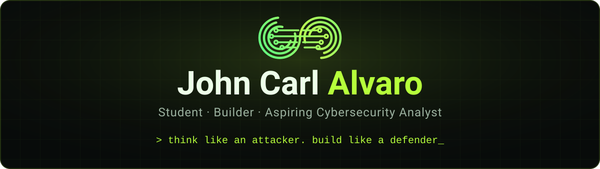

<div align="center">



<br>

[](https://jclabs-dev.vercel.app)
[](https://www.linkedin.com/in/john-carl-alvaro-2b11053b2/)
[](https://github.com/jcbuconut227?tab=repositories)

</div>

---

## `01` — About me

```toml
[profile]
name      = "John Carl 'JC' Alvaro"
role      = "BSIT student, aspiring cybersecurity analyst"
location  = "Plaridel, Bulacan, Philippines"
focus     = ["cybersecurity", "web development", "networking basics"]
status    = "open to OJT and part-time opportunities"
```

I'm a 4th-year IT student who is drawn to the parts of the internet most people never see, and I want to help keep them safe. I study how things break so I can build things that don't. Outside of class, I help run my parish's youth programs, which taught me how to plan, delegate, and explain things clearly.

---

## `02` — Skills & tools

<div align="center">

**LANGUAGES**<br>


**FRAMEWORKS & LIBRARIES**<br>


**DATA, 3D & CLOUD**<br>


**TOOLS & DEPLOYMENT**<br>


**SECURITY & NETWORKING**<br>


</div>

Also: ASP.NET Core, SQL Server, Swagger, Windows Forms, Canva, and Ethernet/UTP cabling.

---

## `03` — Projects

| Project | What it is | Links |
|:--|:--|:--|
| **Hidepix** | A browser-based tool that hides messages inside PNG images, with optional AES-GCM password protection and a detection tab. Everything runs on the device. | [Live](https://hidepix.vercel.app) · [Code](https://github.com/jcbuconut227/Hidepix) |
| **SariSync** | A POS and inventory system for sari-sari stores: a Windows Forms admin app plus a web API for online ordering. | [Live](https://sarisync-jet.vercel.app/login) · [Code](https://github.com/jcbuconut227/SariSync) |
| **AnatomiaLearn 3D** | My capstone: a gamified 3D anatomy learning app with quizzes, classrooms, and teacher dashboards. | [Live](https://anatomia-website.vercel.app) · [Code](https://github.com/jcbuconut227/Anatomixs) |
| **JCLabs** | My portfolio site, with a terminal-style loading screen, a certificate viewer, and a working contact form. | [Live](https://jclabs-dev.vercel.app) · [Code](https://github.com/jcbuconut227/JCLabs) |

---

## `04` — Certificates

- **Information Session on Digital Citizenship**, DICT Bulacan (Oct 2026)
- **Responsible AI in Everyday Life**, DICT Bulacan (Apr 2026)
- **Introduction to Cybersecurity**, Cisco Networking Academy (Nov 2025)
- **Stay Safe Online: Cybersecurity Basics**, DICT Bulacan (Nov 2025)
- **The Road to Digitalization Leads through Cybersecurity**, DICT Bulacan (Oct 2025)
- **Robotics Training and Workshop**, Felta Techvoc Academy (Nov 2024)

You can open each one on my [portfolio](https://jclabs-dev.vercel.app/#certificates).

---

## `05` — Let's connect

<div align="center">

I'm open to OJT and part-time opportunities, and always happy to talk about cybersecurity or web projects.

[](https://jclabs-dev.vercel.app)
[](https://github.com/jcbuconut227)
[](mailto:alvarojohncarl495@gmail.com)


</div>
